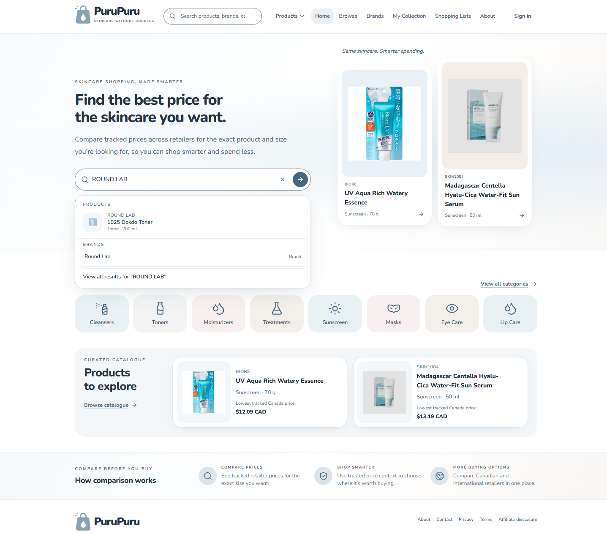
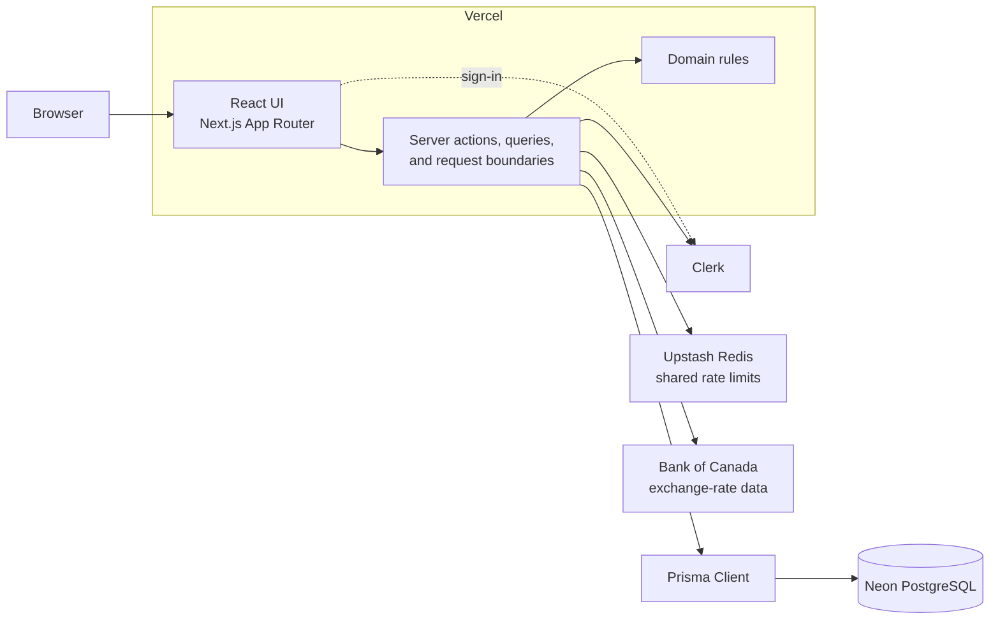
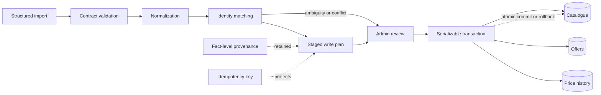

# PuruPuru

PuruPuru is a skincare shopping, discovery, and independent price-comparison platform for Canadian shoppers. It combines an image-first storefront with trustworthy retailer comparison for the exact product and size someone wants.

**Live application:** [purupuru.ca](https://www.purupuru.ca/)

## Tech stack

| Area | Technologies |
| --- | --- |
| Frontend | Next.js 15, React 19, TypeScript, Tailwind CSS, shadcn/ui conventions, Lucide icons |
| Application layer | Next.js App Router, server components, server actions, runtime input validation |
| Data | PostgreSQL, Prisma, Neon |
| Authentication and infrastructure | Clerk, Upstash Redis, Vercel |
| External data | Bank of Canada exchange-rate data |
| Tooling | pnpm workspaces, ESLint, Node test runner |

## Engineering highlights

- **Family-level storefront, exact-size prices:** discovery uses one image-first card per product family while every displayed price and outbound link remains tied to its actual purchasable size.
- **Normalized capacity filtering:** compatible volume or mass units are normalized for filtering while incompatible dimensions remain separate.
- **Market-aware price comparison:** offers retain native currency, availability, and explicit customer markets; Canadian shoppers receive approximate CAD presentation without replacing the source price.
- **Structured commerce model:** PostgreSQL and Prisma model product families, meaningful versions, exact-size variants, retailers, offers, benchmark prices, and historical observations separately.
- **Reviewed ingestion pipeline:** versioned imports pass runtime validation, normalization, provenance capture, and conservative identity matching before an administrator can approve a write plan.
- **Safe catalogue writes:** idempotency keys, stable retailer identities, serializable transactions, stale-plan revalidation, and atomic rollback prevent duplicate or partial product graphs.
- **Private user data:** Clerk identities resolve to local users, and collection, rating, purchase, and shopping-list reads and mutations enforce ownership.
- **Boundary-focused quality:** 159 automated tests cover domain invariants, ingestion behavior, authorization and security boundaries, missing-data semantics, and structural UX contracts.

## Why I built it

Skincare products are often sold by several domestic and international retailers, but comparing them is difficult because listings vary by size, currency, availability, packaging, and naming. I built PuruPuru to normalize listings around the product and size a shopper actually wants, then make the tracked buying options easy to compare.

## Architecture

Public catalogue reads do not require authentication. Private operations resolve the verified Clerk identity to a local user, while domain rules remain separate from React and Prisma so they can be tested directly.

## Product ingestion architecture

Import submissions never publish automatically. Ambiguous identity remains visible for review, and approval revalidates the plan inside the same atomic transaction that writes catalogue records, offers, and price observations.

## Interesting engineering decisions

- **Browse families, price exact variants:** discovery avoids repeating every size while retaining explicit variant context for prices, filtering, comparison, and product links.
- **Size is the normal shopper-facing distinction:** `ProductVersion` remains an internal exception for formula or release differences that materially affect a purchase.
- **Native currency is authoritative:** CAD conversion is presentation-only and can fail without hiding or rewriting the original price.
- **Ranking is affiliate-neutral:** tracked product price determines default ordering; commissions and opaque “best deal” scores do not.
- **Uncertainty is explicit:** low-confidence imports become review outcomes instead of silently creating or merging catalogue identity.

## Testing and quality

The repository currently has **159 automated tests** covering pure domain rules, ingestion planning and transaction behavior, ownership and security boundaries, offer and benchmark semantics, and source-level UX contracts. The normal verification pass also includes linting, workspace typechecking, Prisma validation/generation, dependency auditing, and a production build.

The suite is intentionally strongest around invariants and failure cases. Source-contract tests and narrow DOM stand-ins are not presented as comprehensive browser E2E or accessibility certification.

For strategy and priorities, see the [product vision](docs/PRODUCT_VISION.md). For implementation detail, see the [architecture](docs/ARCHITECTURE.md), [data model](docs/DATA_MODEL.md), [ingestion design](docs/INGESTION.md), and [testing approach](docs/TESTING.md).

---

Source code is publicly viewable for portfolio and evaluation purposes. All rights reserved.

### Like feature rollout

Authenticated hearts and `/likes` use one PostgreSQL ProductLike per meaningful version, shared across sizes. `/collection` redirects to Likes; `/collection/legacy` preserves existing history. Apply the additive `20261020120000_add_product_likes` migration through the normal reviewed deployment workflow before serving the new code. It performs no legacy backfill or destructive changes. A ten-minute HTTP-only request cookie supports Clerk authentication continuation; there is no guest Like collection. Optional PostHog events are independent of Like persistence and require affirmative analytics consent.

A local Next.js process can still point to the production database: verify `DATABASE_URL`, `DIRECT_URL`, and the linked Neon branch before applying migrations. For an approved target, the deployment migration command is `pnpm --filter @beauty-platform/database prisma:migrate:deploy` (not `migrate dev` or `db push`). A Prisma `P2021` for `public.ProductLike` indicates that the Likes migration is missing on that connection. Guest modal closure and retryable errors do not substitute for applying the required schema migration.

### PostHog Phase 1 rollout

Supply `NEXT_PUBLIC_POSTHOG_KEY` securely and `NEXT_PUBLIC_POSTHOG_HOST=https://us.i.posthog.com` at web build time (US project 677697). Without both valid values, collection stays off. Development, test, localhost and Vercel preview builds do not capture. Phase 1 needs no new dependency or migration. Complete the privacy/retention/US-processing review described in `docs/ARCHITECTURE.md` before enabling the production configuration.

To verify after an approved deployment, open PostHog project 677697's Live Events view and accept analytics in a fresh browser tab. Navigate between catalogue/product pages, select another size, follow a retailer link and save/remove a Like while authenticated. Expect `$pageview`, `product_viewed`, `retailer_outbound_clicked`, `like_added` and `like_removed` with canonical IDs. Native pageviews replace `page_viewed`; historical custom events remain untouched. Rerenders and repeated idempotent saves must not add events. Check schema version 2, a sanitized `$current_url` such as `https://www.purupuru.ca/products/[slug]`, matching `$pathname`/`$host`, and one UUIDv7 `$session_id` across the tab's events. Check Activity's URL column and Web Analytics Live/pageviews/paths for new traffic, clearing old URL/event filters. No raw slugs, queries, fragments or account data should appear. Reject or withdraw via footer preferences and confirm new collection stops; Likes and retailer links must still work. Events already received remain subject to the project's retention/deletion policy. Session IDs reset on reload/withdrawal and rotate after 30 minutes of recorded inactivity or 24 hours. Returning visitors, attribution, device data and engagement metrics remain limited; see `docs/ARCHITECTURE.md`. Network blockers can undercount; outbound clicks do not establish purchases.
